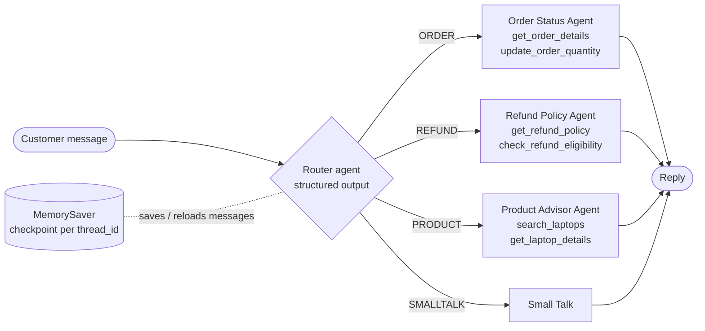

# TechNova Laptops: Agentic Customer Service Chatbot

A multi-agent customer service and sales assistant built with **LangGraph** and the **Google AI (Gemini) API**. OpenAI also works. A router agent reads each customer message and sends it to one of three specialist agents. **LangGraph MemorySaver** keeps the whole conversation, so the bot remembers names, order IDs, budgets and needs across turns.

Adapted from the starter code [myrah/build-ai-agents-and-chatbots-with-langgraph-2021112](https://github.com/myrah/build-ai-agents-and-chatbots-with-langgraph-2021112). The Azure OpenAI client was replaced with Gemini/OpenAI, and the hard-coded API key was replaced with secrets loaded from `.env`, Colab Secrets or Codespaces secrets.

## Architecture



| Component | What it does |
|---|---|
| **System prompt** (`BASE_SYSTEM_PROMPT`) | Defines "Nova", TechNova's customer service and sales assistant. Every agent gets it, so the tone stays the same across agents. |
| **Router agent** | Uses `with_structured_output` to pick `ORDER`, `REFUND`, `PRODUCT` or `SMALLTALK`. It reads the full history, so follow-ups like "when will it arrive?" are routed correctly. |
| **Order Status Agent** | Looks up an order's product, quantity, delivery date and status. It can change the quantity while the order is in transit. |
| **Refund Policy Agent** | Quotes the return policy. It checks a specific order's eligibility (in-transit cancellation, the 14-day return window, the restocking fee) and works out the refund amount. |
| **Product Advisor Agent** | Recommends laptops by budget, use case and shipping time, and answers spec and price questions. |
| **MemorySaver** | Checkpoints the graph state after every turn, keyed by `thread_id`. On each new turn LangGraph reloads the earlier messages, and every agent sees them. |

Each specialist is a small tool-calling loop (`LLM → tools → LLM → … → answer`), the same pattern as the starter's `OrdersAgent`. Only the agent's final answer is written back to shared memory. Its internal tool calls stay private, which keeps the history short.

## Run it

### Google Colab (easiest)
1. Open `customer_service_chatbot.ipynb` in Colab (File → Open notebook → GitHub tab → paste this repo's URL).
2. Click the 🔑 **Secrets** icon in the left sidebar → **Add new secret**. Name it `GOOGLE_API_KEY` and paste a key from <https://aistudio.google.com/apikey>. Turn on *Notebook access*.
3. In the first code cell, replace `YOUR-USERNAME/YOUR-REPO`. Then choose **Runtime → Run all**.

### GitHub Codespaces
Add `GOOGLE_API_KEY` at <https://github.com/settings/codespaces> (New secret), open a Codespace on this repo, then run:
```bash
pip install -r requirements.txt
python chatbot.py --demo
```

### Locally / VS Code
```bash
pip install -r requirements.txt
cp .env.example .env        # then put your key in .env
python chatbot.py --demo    # scripted demo, saves outputs/demo_transcript.txt
python chatbot.py           # chat interactively
```
`.env` is in `.gitignore`, so the key is never committed. To use OpenAI instead, set `LLM_PROVIDER=openai` and `OPENAI_API_KEY` in `.env`. You can change the model with `MODEL_NAME`.

## Demo conversations

`python chatbot.py --demo` runs two 6-turn conversations:

1. **Order + refund.** The customer gives their name and `ORD-6948`, checks its status, changes the quantity, then asks about cancelling ("it"). The refund amount uses the *updated* quantity. Last, the customer asks "what's my name and which order were we talking about?"
2. **Product + refund.** The customer gives a use case (video editing), then a budget, then asks "how fast does *that one* ship?" and "anything within 3 days in my budget?". It ends with a return question about the laptop just recommended.

Together they cover all three agent types plus small talk, and memory across more than 3 turns. The saved output is in [`outputs/demo_transcript.txt`](outputs/demo_transcript.txt).

## Files

| File | Purpose |
|---|---|
| `chatbot.py` | All agents, tools, router graph, MemorySaver, demo and CLI (commented) |
| `customer_service_chatbot.ipynb` | Colab notebook: builds the bot, draws the graph, runs the demo, inspects memory |
| `data/` | Order and pricing CSVs from the starter repo |
| `.env.example` | Template for your API key (copy to `.env`) |
| `outputs/demo_transcript.txt` | Console output from a successful demo run |

> Note: the order data is from October 2024, so the bot treats **2024-10-20** as "today". This makes delivery status and refund windows realistic.
